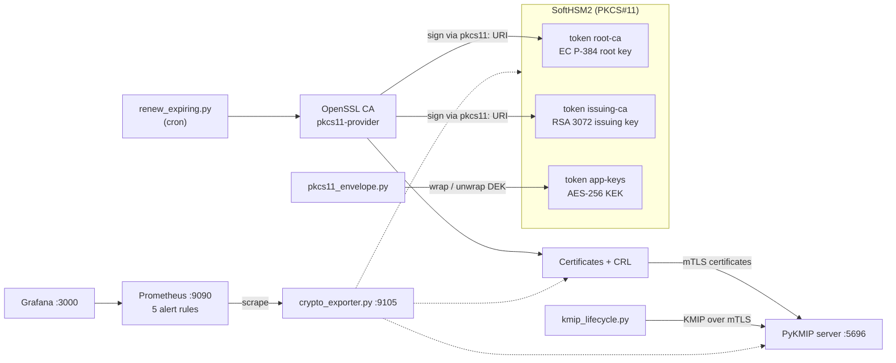
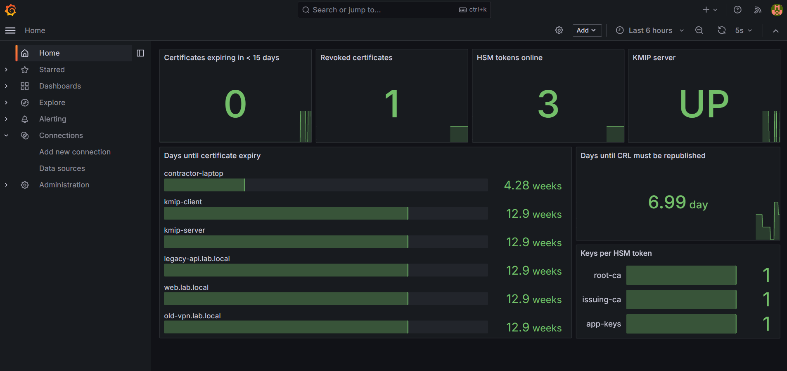
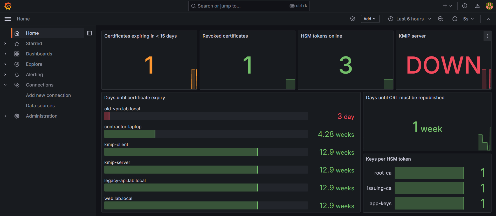
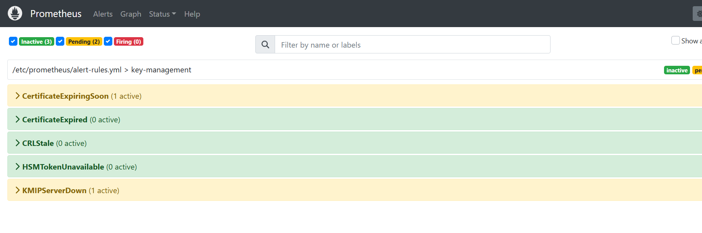

# key-management-lab

[](https://github.com/fa1829/key-management-lab/actions/workflows/lab.yml)


A hands-on lab for the three pillars of enterprise key management: **HSM**, **KMS** and **PKI**.

Keys are generated and used inside an HSM through **PKCS#11**. A two-tier certificate authority
signs with keys that never leave the HSM. A **KMIP** server takes encryption keys through their
full lifecycle over mutual TLS. **Prometheus** and **Grafana** watch the whole estate, and an
automation job renews certificates before they expire.

Everything runs on one Ubuntu machine (or WSL 2) in about a minute, using free tools that speak the
same standards as the enterprise products:

| Enterprise product | Lab stand-in | Shared standard |
| --- | --- | --- |
| Thales Luna HSM, partitions | SoftHSM2, tokens | PKCS#11 v2.40 |
| CipherTrust Manager (KMS) | PyKMIP server | KMIP over mutual TLS, port 5696 |
| Enterprise certificate authority | OpenSSL 3 + PKCS#11 provider | X.509 v3, CRL (RFC 5280) |
| Observability stack | Prometheus + Grafana | OpenMetrics, PromQL |

> **Demo credentials only.** PINs and passwords live in `config/lab.env` and
> `monitoring/docker-compose.yml`. They exist to make a disposable lab easy to run; never reuse them.

---

## Contents

- [What the lab demonstrates](#what-the-lab-demonstrates)
- [Architecture](#architecture)
- [Quick start](#quick-start)
- [Modules](#modules)
- [Monitoring](#monitoring)
- [Repository layout](#repository-layout)
- [How it was tested](#how-it-was-tested)
- [Limits, stated plainly](#limits-stated-plainly)
- [Roadmap](#roadmap)
- [Documentation](#documentation)

## What the lab demonstrates

| Capability | Evidence you can show |
| --- | --- |
| Keys generated **inside** an HSM and marked non-extractable | `Access: sensitive, always sensitive, never extractable, local` on every private key |
| An application **cannot read** an HSM key | Reading `CKA_VALUE` returns `CKR_ATTRIBUTE_SENSITIVE` |
| **Envelope encryption** with a KEK in the HSM | A per-record DEK is wrapped with AES key wrap (RFC 5649) and unwrapped inside the token |
| **HSM-backed PKI** | `openssl ca` signs with a `pkcs11:` URI; the root certificate's public key matches the HSM key |
| **Revocation** | A CRL signed in the HSM makes `openssl verify -crl_check` fail with *certificate revoked* |
| **KMIP integration** | A Python client authenticates with a certificate from the lab PKI and drives the server |
| **Key lifecycle** (NIST SP 800-57) | One key goes Pre-Active, Active, Deactivated, Destroyed; another goes Compromised |
| **Rotation done in the right order** | Data is re-encrypted under v2 before v1 is deactivated |
| **Certificate automation** | Certificates within 15 days of expiry are renewed with a new key; revoked ones are skipped |
| **Observability** | Metrics for expiry, revocation, CRL freshness, HSM and KMS health, with five alert rules |

## Architecture



Sequence diagrams for issuance, envelope encryption and rotation: [`docs/ARCHITECTURE.md`](docs/ARCHITECTURE.md).

## Quick start

On **Ubuntu 24.04** or **WSL 2 with Ubuntu 24.04** (first time on WSL? follow
[`docs/SETUP-WSL.md`](docs/SETUP-WSL.md) step by step):

```bash
git clone https://github.com/fa1829/key-management-lab.git
cd key-management-lab
make install     # apt packages + two Python environments, about 5 minutes
make doctor      # pre-flight check: shows anything missing
make demo        # modules 01-04 end to end, about a minute
```

`make help` lists every target. `make reset` wipes all generated state and runs the demo again.

## Modules

| # | Command | What happens | What it proves |
| --- | --- | --- | --- |
| 01 | `make hsm` | Creates three tokens (like Luna partitions) and generates an EC P-384 root key, an RSA 3072 issuing key and an AES-256 KEK inside them; signs a message in the HSM and verifies it outside | Keys are born in the HSM and stay there |
| 01 | `make envelope` | Wraps a per-record DEK under the KEK, decrypts the record after unwrapping inside the HSM | Envelope encryption; key values cannot be read out |
| 02 | `make pki` | Builds a root CA and an issuing CA whose private keys stay in the HSM, then issues five certificates | HSM integration through PKCS#11 URIs; chain building |
| 02 | `make revoke` | Revokes one certificate for key compromise and publishes a CRL signed in the HSM | Revocation and CRL checking |
| 03 | `make kmip-start` `make kmip-demo` | Starts a KMIP server on mutual TLS and walks keys through every lifecycle state | KMIP integration and NIST SP 800-57 states |
| 04 | `make metrics` `make exporter` | Publishes certificate, CRL, HSM and KMIP health as Prometheus metrics | Observability for crypto services |
| 04 | `make renew-dry` `make renew` | Renews certificates within 15 days of expiry, with new keys; never auto-renews revoked ones | Automation of certificate workflows |

A guided walkthrough with expected output and exercises for each module is in
[`docs/MODULES.md`](docs/MODULES.md). Real output of a full run is in
[`docs/sample-output.txt`](docs/sample-output.txt).

<details>
<summary>Excerpt: the KMIP lifecycle run</summary>

```text
[1] Create AES-256 payments-dek-v1       key 1    state=PRE_ACTIVE   generated by the server, not yet usable
[2] Activate v1                          key 1    state=ACTIVE
[5] Rotate: create + activate v2         key 2    state=ACTIVE       new writes use v2
[6] Re-encrypt old record: v1 -> v2      key 2    state=ACTIVE       data migrated before v1 is retired
[7] Deactivate v1 (revoke: superseded)   key 1    state=DEACTIVATED  archived
[8] Encrypt with deactivated v1          key 1    state=DEACTIVATED  refused (PERMISSION_DENIED)
[10] Destroy v1                          key 1    state=DESTROYED    get() now fails (ITEM_NOT_FOUND)
[11] Revoke batch-export-key: compromise key 3    state=COMPROMISED  must never protect data again
```
</details>

## Monitoring

```bash
make kmip-start && make exporter   # terminal 1: metrics on http://localhost:9105/metrics
make monitoring-up                 # terminal 2: Prometheus and Grafana in Docker
```

Open **Grafana at http://localhost:3000** (`admin` / `labadmin`) for the *Key Management Lab -- Crypto
Estate* dashboard, and **Prometheus at http://localhost:9090/alerts** for the alert rules:

| Alert | Fires when | Severity |
| --- | --- | --- |
| `CertificateExpiringSoon` | a non-revoked certificate has under 15 days left (for 5 minutes) | warning |
| `CertificateExpired` | a non-revoked certificate is past its end date | critical |
| `CRLStale` | the CRL must be republished within 2 days | critical |
| `HSMTokenUnavailable` | an HSM token stops answering on PKCS#11 (for 1 minute) | critical |
| `KMIPServerDown` | the KMIP port refuses connections (for 2 minutes) | critical |

### What it looks like

Normal state: one revoked certificate (`contractor-laptop`, revoked on purpose), every HSM token
answering, the KMIP server up and a fresh CRL.



Incident: a 3-day certificate (`old-vpn.lab.local`) was issued and the KMIP server was stopped.
The dashboard turns orange and red within one scrape:



Prometheus has picked up both problems. Each alert stays *Pending* for its `for:` period (2 minutes
for `KMIPServerDown`, 5 for `CertificateExpiringSoon`), so a short blip never pages anyone. It
changes to *Firing* only if the problem is still there when that time is up:



Recovery is two commands: `make renew` issues `old-vpn.lab.local` again with a **new key** and
90 days of validity, and `make kmip-start` brings the KMS back. Both alerts then clear.

The containers use host networking so they reach the exporter on `localhost`. This works with
Docker Engine inside WSL or on Linux; Docker Desktop notes are in
[`docs/TROUBLESHOOTING.md`](docs/TROUBLESHOOTING.md).

## Repository layout

```text
key-management-lab/
├── Makefile                     every entry point: make help
├── config/lab.env               paths and demo PINs, sourced by every script
├── scripts/
│   ├── 00_install.sh            apt packages, uv, two Python environments
│   ├── 00_doctor.sh             pre-flight check
│   ├── 01_hsm_init.sh           three SoftHSM tokens
│   ├── 01_hsm_keys.sh           keys generated inside tokens; HSM signing
│   ├── 02_pki_build.sh          root and issuing CA with HSM keys; leaf certificates
│   ├── 02_pki_issue.sh          issue or re-issue one certificate (--rekey rotates the key)
│   ├── 02_pki_revoke.sh         revoke and publish a CRL
│   └── 03_kmip_server.sh        start, stop, status of the KMIP server
├── python/
│   ├── pkcs11_envelope.py       envelope encryption through PKCS#11
│   ├── kmip_lifecycle.py        full key lifecycle over KMIP
│   ├── crypto_exporter.py       Prometheus exporter
│   └── renew_expiring.py        certificate renewal job
├── monitoring/                  docker compose, Prometheus config, alert rules, Grafana dashboard
├── docs/                        setup guide, module walkthrough, architecture, troubleshooting
├── .github/workflows/lab.yml    CI: installs and runs the whole lab on every push
└── run/                         generated tokens, certificates, KMIP database (git-ignored)
```

## How it was tested

- `make install`, `make doctor`, `make demo` and `make renew` passed from a fresh unzip on
  Ubuntu 24.04 (OpenSSL 3.0.13, SoftHSM 2.6.1, pkcs11-provider 0.3, PyKMIP 0.11 on Python 3.11).
- The monitoring stack was run live on WSL 2 (Ubuntu 24.04, Docker Engine inside WSL, Prometheus
  2.54.1, Grafana 11.2.0). Prometheus scraped the exporter, all five rules loaded, and Grafana
  showed every panel. Issuing a 3-day certificate and stopping the KMIP server sent
  `CertificateExpiringSoon` and `KMIPServerDown` to pending, and the dashboard showed both problems.
  `make renew` and `make kmip-start` cleared both alerts (screenshots above).
- The GitHub Actions workflow repeats the install and the full run on every push. CI does not start
  the Docker monitoring stack.

## Limits, stated plainly

- **SoftHSM is not an HSM.** It implements the PKCS#11 interface faithfully but has no tamper
  resistance, no FIPS 140-3 validation, no M of N quorum and no backup or high availability.
- **PyKMIP is a reference server, not an enterprise KMS.** No clustering, admin console, connectors
  or role model. It is stricter than NIST SP 800-57 and refuses decryption with a deactivated key,
  which is why the rotation step re-encrypts first.
- **End-entity keys are files** with 600 permissions; production would hold high-value ones in an HSM.
- **CRLs only**, no OCSP responder; **no ACME**.
- **Renewal does not revoke the certificate it replaces.** The old certificate stays valid until
  it expires. That is fine for routine expiry, but if you rotate because a key leaked, you must
  also revoke the old certificate (`./scripts/02_pki_revoke.sh <cn> superseded`).
- **No alert delivery.** Alerts are visible in Prometheus only; there is no Alertmanager routing to
  e-mail or chat yet (see roadmap).

## Roadmap

- [ ] OCSP responder signed by an HSM-held key
- [ ] HashiCorp Vault PKI and Transit engines as a second KMS
- [ ] PowerShell equivalents of the renewal and monitoring scripts
- [ ] Server TLS keys held in the HSM through the PKCS#11 provider
- [ ] Alertmanager with e-mail or chat routing

## Documentation

| Document | Read it for |
| --- | --- |
| [`docs/SETUP-WSL.md`](docs/SETUP-WSL.md) | Step by step from a downloaded zip to a published GitHub repository |
| [`docs/MODULES.md`](docs/MODULES.md) | What each module does, expected output, things to try |
| [`docs/ARCHITECTURE.md`](docs/ARCHITECTURE.md) | Components, trust boundaries and sequence diagrams |
| [`docs/key-lifecycle.md`](docs/key-lifecycle.md) | Key states, lifecycle operations and controls |
| [`docs/TROUBLESHOOTING.md`](docs/TROUBLESHOOTING.md) | Fixes for the errors you are most likely to meet |

## License

[MIT](LICENSE)
