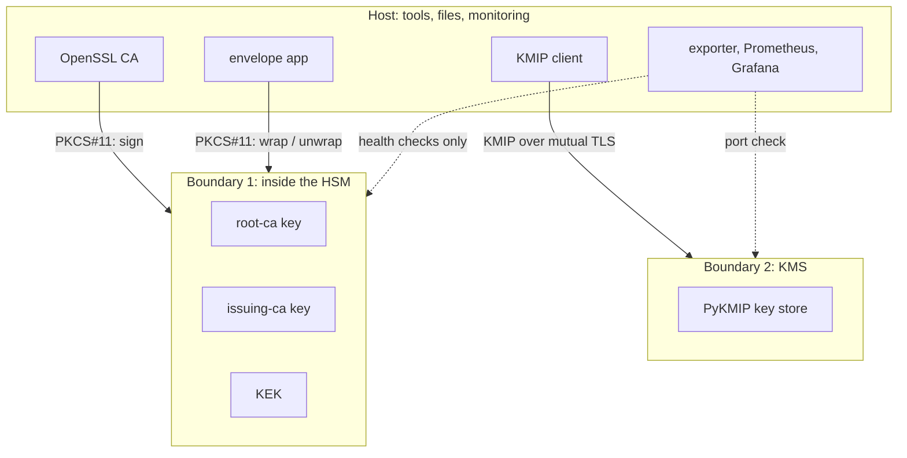
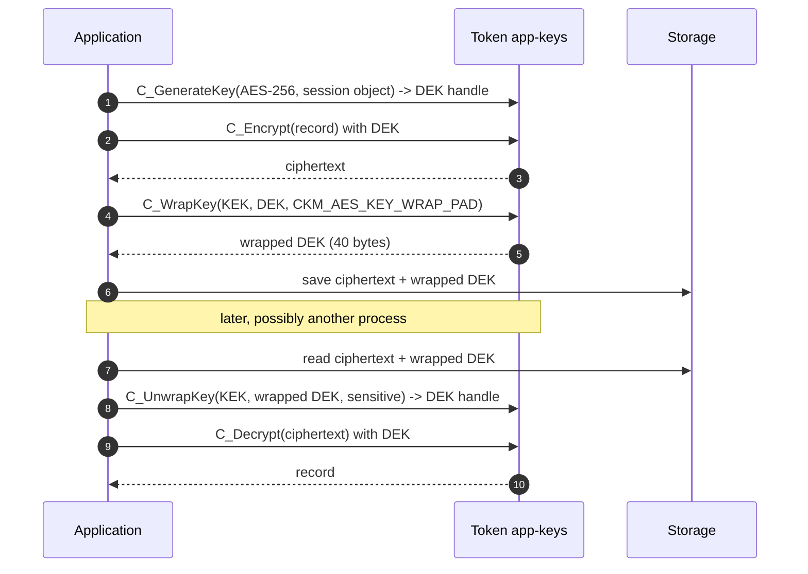
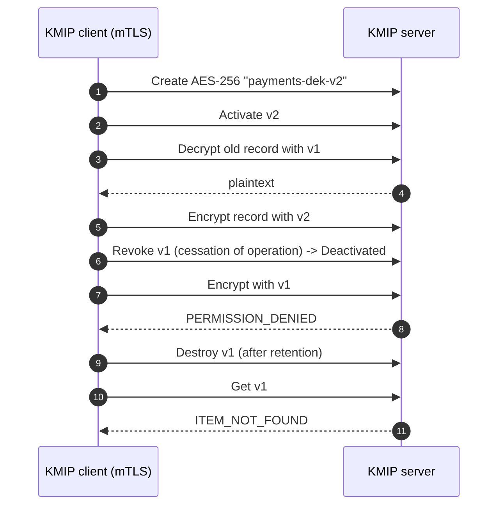

# Architecture

The lab has one rule: **private and secret keys are created in the HSM and stay there.** Every
other component either asks the HSM to perform an operation through PKCS#11, or holds only public
material, ciphertext and wrapped keys.

## Components

| Component | Role | Talks to | Holds secrets? |
| --- | --- | --- | --- |
| SoftHSM2, tokens `root-ca`, `issuing-ca`, `app-keys` | HSM: generates and uses keys | nothing; it is called | Yes: all CA keys and the KEK, non-extractable |
| OpenSSL 3 + `pkcs11-provider` | Certificate authority tooling | HSM through PKCS#11 | No: it holds `pkcs11:` URIs, not keys |
| `pkcs11_envelope.py` | Application doing envelope encryption | HSM through PKCS#11 | Only a transient session DEK |
| `run/pki/` | Certificates, CA database, CRL | read by everything | End-entity keys only (files, mode 600) |
| PyKMIP server, port 5696 | Key management system | clients over mutual TLS | Yes: managed AES keys in its database |
| `kmip_lifecycle.py` | KMIP client | KMIP server | Its client TLS key |
| `crypto_exporter.py`, port 9105 | Prometheus exporter | HSM, PKI files, KMIP port | No |
| `renew_expiring.py` | Renewal automation | OpenSSL CA | Writes new end-entity keys |
| Prometheus 9090, Grafana 3000 | Monitoring and alerting | exporter | No |

## Trust boundaries



Crossing into boundary 1 requires the token PIN (a Luna partition would add PED keys or M of N
quorum). Crossing into boundary 2 requires a client certificate issued by the lab CA.

## Flow 1: issuing a certificate with an HSM-held CA key

```mermaid
sequenceDiagram
  autonumber
  participant Op as Operator / renewal job
  participant SSL as OpenSSL (openssl ca)
  participant Prov as PKCS#11 provider
  participant HSM as Token issuing-ca
  Op->>SSL: CSR + extensions + -keyfile pkcs11:token=issuing-ca;object=issuing-ca-key
  SSL->>Prov: load key by URI
  Prov->>HSM: C_OpenSession, C_Login(User PIN), C_FindObjects
  SSL->>SSL: build TBSCertificate, hash it (SHA-256)
  SSL->>Prov: sign(digest)
  Prov->>HSM: C_SignInit(CKM_RSA_PKCS) + C_Sign
  HSM-->>Prov: signature (the key never leaves)
  Prov-->>SSL: signature
  SSL-->>Op: signed certificate + updated index.txt
```

## Flow 2: envelope encryption



## Flow 3: key rotation over KMIP



## Key inventory

| Key | Algorithm | Where | Purpose | Rotated by |
| --- | --- | --- | --- | --- |
| `root-ca-key` | EC P-384 | HSM token `root-ca` | signs the issuing CA and root CRL | new root ceremony (not automated) |
| `issuing-ca-key` | RSA 3072 | HSM token `issuing-ca` | signs leaf certificates and the CRL | new issuing CA signed by root |
| `kek-v1` | AES-256 | HSM token `app-keys` | wraps DEKs | new KEK, re-wrap DEKs |
| session DEKs | AES-256 | HSM session only | encrypt one record | a new DEK per record |
| `payments-dek-v*` | AES-256 | KMIP server | application data keys | `kmip_lifecycle.py` |
| leaf keys | RSA 2048 | `run/pki/keys/` | TLS for servers and clients | `renew_expiring.py --rekey` |

## Design decisions

| Decision | Why | Trade-off |
| --- | --- | --- |
| Three tokens instead of one | Mirrors separating keys by purpose into Luna partitions | More PINs to manage |
| EC P-384 root, RSA 3072 issuing CA | Shows both families; RSA is still the most widely compatible for issuing | Mixed algorithms complicate policy |
| OpenSSL PKCS#11 provider | Standard OpenSSL 3 route to HSM keys, same as production | Needs Ubuntu 24.04 packages |
| PyKMIP for the KMS | Free, standards-based KMIP server | Not enterprise-grade; stricter on deactivated keys |
| Renewal always re-keys | Limits the lifetime of each key pair, not only each certificate | Clients pinning keys would break |
| Host-network monitoring containers | Containers see the exporter on localhost in WSL and Linux | Docker Desktop needs host networking turned on |
